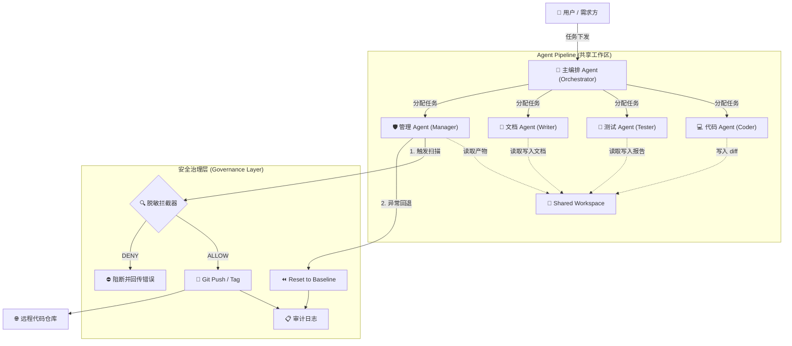

<div align="center">

# 🛡️ AgentSentinel

**A Secure, Governed, and Self-Healing Multi-Agent Development Pipeline.**

**安全受控、支持版本回退的多智能体研发流水线**

[](https://www.python.org/)
[](https://github.com/modelscope/agentscope)
[](#)
[](#)
[](https://opensource.org/licenses/MIT)

</div>

---

## 📖 简介 (Introduction)

**AgentSentinel** 是一套面向企业级研发场景的多智能体（Multi-Agent）协作系统。针对目前大模型 Agent 在真实业务中常遇到的“上下文污染”、“工具越权”和“敏感数据泄露”等痛点，本系统引入了 **主管编排 (Supervisor)** 架构与 **运行时权限拦截 (Permission Interception)** 机制。

系统内置 5 个专业角色 Agent，覆盖从需求规划、代码编写、自动化测试、文档撰写到代码仓库推送的完整生命周期，并提供**不可绕过的脱敏扫描**与**版本原子级回退**能力。

## ✨ 核心特性 (Features)

- 🧠 **主管编排模式 (Supervisor Pattern)**：主编排 Agent 统筹全局，专家 Agent 独立执行，上下文物理隔离，避免长任务带来的上下文溢出。
- 🚫 **不可绕过的脱敏拦截**：代码与文档在推送前强制经过静态扫描，基于底层权限系统（ALLOW/DENY/ASK），一旦发现敏感信息即刻终止，**拒绝自行重试绕过**。
- 🔄 **版本回退与闭环反馈**：测试失败自动反馈至代码 Agent；严重故障时，由主编排一键触发仓库版本回退（Revert to Baseline）。
- 📝 **全链路审计日志**：每次操作生成结构化记录（`workspace/audit/push-log.jsonl`），确保每一次推送、拦截和回退都有迹可循。
- 🛠️ **基于 AgentScope 构建**：利用共享 Workspace 交换产物，天然支持大负载上下文卸载（Offloading）。

---

## 🏗️ 系统架构 (Architecture)

本项目采用 **Supervisor** 模式：`SentinelPipeline` 负责编排，主编排 Agent 作为中枢，通过共享工作区与工具调用调度四大专家。AgentScope 2.0.8 不提供 `TeamPipeline`，编排基于 `Agent` + 工具调用 + 会话状态机实现。



---

## 🤖 角色矩阵 (Agent Matrix)

| Agent 角色 | 核心职责 | 关键技能 / 工具 (Skills) | 权限管控要点 |
| :--- | :--- | :--- | :--- |
| **Orchestrator** <br/>🧠 主编排 | 拆解需求、分派任务、全局状态维护、触发回退 | `TeamAssign`, `query_task_status`, `request_publish`, `request_revert` | 禁止直接执行代码或 Git 操作 |
| **Coder** <br/>💻 代码专家 | 根据需求实现代码、根据测试报告修复 Bug | `file_write`, `file_edit`, `bash` (仅限构建/语法检查) | 禁止执行 `git` 命令 |
| **Tester** <br/>🧪 测试专家 | 独立验证代码产物、输出结构化测试报告 | `file_read`, `bash` (执行测试，含 `regression-suite`) | 必须与 Coder 上下文隔离，防自我评估偏差 |
| **Writer** <br/>📝 文档专家 | 根据代码 Diff 更新技术文档、生成变更摘要 | `file_read`, `file_write`, `file_edit` (含 `doc-consistency-check`) | 必须明确反映已通过测试的实际变更 |
| **Manager** <br/>🛡️ 管理专家 | 脱敏扫描、仓库推送、打基线、版本回退、写审计日志 | `sanitize_scan`, `git_commit`, `git_push`, `git_tag_baseline`, `git_reset_to_baseline`, `audit_logger` | 高危工具强制设为 `ASK`，`force push` 设为 `DENY` |

---

## 🚀 快速开始 (Quick Start)

### 1. 环境准备

本项目推荐使用 **Python 3.12+**，并基于 **AgentScope 2.0.8** 构建。推荐使用 `uv` 作为包管理器。

```bash
# 克隆仓库
git clone https://github.com/PPACT/AgentSentinel.git
cd AgentSentinel

# 初始化 Python 3.12 虚拟环境（严格遵守 AGENTS.md 规则）
uv venv --python 3.12
source .venv/bin/activate  # Linux/macOS
# .venv\Scripts\activate   # Windows

# 安装依赖
uv pip install -r requirements.txt
```

### 2. 环境变量配置

请在项目根目录创建 `.env` 文件，配置大模型 API Key 及 Git 凭证。⚠️ 注意：请务必确保 `.env` 文件已添加到 `.gitignore` 中，防止敏感凭证被意外提交。

```env
SENTINEL_OPENAI_API_KEY=<你的 API Key，形如 sk-<字母数字串>>
SENTINEL_GIT_USER_NAME="AgentSentinel Bot"
SENTINEL_GIT_USER_EMAIL="bot@agentsentinel.local"
SENTINEL_GIT_REMOTE_URL="https://github.com/your-org/target-repo.git"
```

### 3. 启动流水线

```python
# main.py (示例)
from agentsentinel.pipeline import SentinelPipeline

# 初始化流水线（默认注入离线脚本模型与受控 Git 工具）
pipeline = SentinelPipeline()

# 下发研发任务
task_prompt = "请开发一个用户登录接口，包含 JWT 鉴权，并补充单元测试和相关文档。"
result = pipeline.run(task_prompt)
print(result.status.value, result.audit_log)
```

离线演示可直接运行：

```bash
uv run python -m agentsentinel run --task "实现用户登录接口"
# 兼容旧参数
uv run python -m agentsentinel --stub
```

---

## 📦 核心依赖 (Dependencies)

项目围绕“安全治理”与“研发交付”场景，显式引入了以下核心依赖（详见 `requirements.txt`）：

```txt
# ===== 核心框架 =====
agentscope[full]==2.0.8

# ===== 治理层（本项目特有） =====
detect-secrets==1.5.0    # 脱敏扫描规则引擎
GitPython>=3.1.42        # Git 操作封装 (Push/Tag/Reset)
pydantic-settings>=2.9.1 # 配置与契约校验
python-dotenv>=1.0.1     # 环境变量加载
structlog>=25.4.0        # 结构化审计日志输出

# ===== 开发与质量检查（对应 AGENTS.md 红线） =====
pytest>=8.0              # 单元测试
ruff>=0.3.0              # 代码规范与格式化
mypy>=1.8.0              # 静态类型检查
```

---

## 🔐 安全与治理 (Security & Governance)

本项目坚决贯彻 **“安全即代码 (Security as Code)”** 的理念，不依赖 LLM 的自我约束：

1. **硬性脱敏拦截**：`sanitize_scan` 工具在 `checkPermissions` 阶段进行运行时正则匹配。若检出敏感信息，抛出 `DENY`，此状态为**业务终态**，严禁 Agent 自动重试。
2. **调用者身份校验**：`git_reset_to_baseline` 等回退指令，需经过严格的 Caller Identity 校验，仅限 Orchestrator 可调用。
3. **审计追踪**：每一次推送、拦截、回退均写入不可篡改的本地 JSONL 日志。

---

## 🤝 贡献与致谢 (Contributing)

- 欢迎提交 Issue 或 Pull Request 优化 Agent 提示词与工作流。
- 本项目架构灵感来源于 [AgentScope](https://github.com/modelscope/agentscope) 的多智能体协作机制与内置权限系统。

<div align="center">

<i>Built with ❤️ for Secure Agentic Workflows.</i>

</div>
